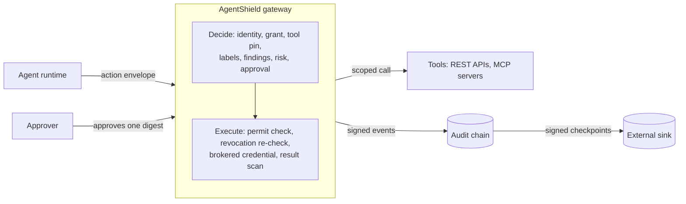
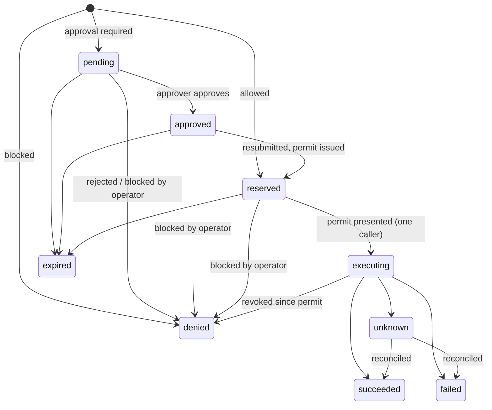

# Architecture

AgentShield sits between an agent and everything the agent can affect. The agent proposes an action; the gateway decides whether it happens, performs it with credentials the agent never holds, and records what it decided and what happened.

This document describes how that works in the code as it stands. For what is deliberately not built, see [Differences from the report](../README.md#differences-from-the-report-and-what-is-not-here).

## The boundary



Two things make this a boundary rather than a suggestion, and both are deployment properties, not code:

1. The agent runtime holds no credential for any protected tool. Only the gateway can resolve `credential_ref`.
2. The agent runtime has no network path to a protected tool that does not pass through the gateway.

If either is false, the agent can go around.

## Who is trusted for what

| Party | Trusted for | Not trusted for |
|---|---|---|
| Agent | Proposing actions | Its own identity, the labels on its data, its risk, whether it has approval, what a tool's schema is |
| Tool / MCP server | Performing the call it was sent | Its own description staying the same; the content of its results |
| Approver | Approving one action digest | Overriding a grant, budget or policy denial |
| Administrator | Grants, registry, catalog, policy activation | Activating a policy they authored, or verifying a tool they registered (two-person rule) |
| Policy signer | What the policy says | Activating it |
| Gateway host owner | Everything | — a host administrator is outside the protection |

## Components

| Component | Responsibility | Source |
|---|---|---|
| Canonical JSON | Strict parsing (duplicate keys rejected), RFC 8785 canonicalization, digests | [src/core/json.ts](../src/core/json.ts) |
| Crypto | Ed25519 signing, JWS compact tokens, AES-256-GCM vault sealing, keyed pseudonyms | [src/core/crypto.ts](../src/core/crypto.ts) |
| Envelope | Validation, binding, digest, argument-to-destination checks | [src/actions/envelope.ts](../src/actions/envelope.ts) |
| Intents | Durable per-action state machine; nonce and idempotency uniqueness | [src/actions/intents.ts](../src/actions/intents.ts) |
| Permits | Issue and verify execution permits | [src/actions/permit.ts](../src/actions/permit.ts) |
| Identity | Principals, agent inventory, suspension and revocation epoch | [src/identity/identity.ts](../src/identity/identity.ts) |
| Grants | Task grants, delegation, attenuation checks | [src/identity/grants.ts](../src/identity/grants.ts) |
| Tool registry | Manifests, pinned revisions, approval, quarantine | [src/registry/tools.ts](../src/registry/tools.ts) |
| Catalog | Destinations, resource labels, accumulated task context | [src/registry/catalog.ts](../src/registry/catalog.ts) |
| Detection | Secret and PII patterns, normalization, redaction, injection heuristics | [src/detect/](../src/detect/) |
| Policy | Signed bundles, the evaluator, risk scoring | [src/policy/](../src/policy/) |
| Ledger | Atomic budget reservations | [src/budget/ledger.ts](../src/budget/ledger.ts) |
| Approvals | Digest-bound approval requests | [src/approvals/approvals.ts](../src/approvals/approvals.ts) |
| Audit | Hash-chained signed events, checkpoints | [src/audit/events.ts](../src/audit/events.ts) |
| Vault | Sealed, expiring redaction mappings | [src/audit/vault.ts](../src/audit/vault.ts) |
| Adapters | REST, MCP and in-process execution; credential broker | [src/executor/adapters.ts](../src/executor/adapters.ts) |
| MCP | Upstream client; agent-facing proxy | [src/mcp/](../src/mcp/) |
| Pipeline | `authorize`, `execute`, scanning and administration | [src/gateway/shield.ts](../src/gateway/shield.ts) |
| Host hooks | Decide-and-record for tools the runtime executes | [src/gateway/hook.ts](../src/gateway/hook.ts) |
| Server | REST routes, MCP endpoint, body limits | [src/gateway/server.ts](../src/gateway/server.ts) |

## The action

An agent submits an **envelope**:

```json
{
  "action_id": "act_1",
  "task_id": "task_123",
  "tool_id": "crm",
  "operation": "crm.read",
  "resource_id": "customer_42",
  "destination_id": "crm.internal",
  "arguments": { "customer_id": "customer_42" },
  "nonce": "nonce_1_abcdef",
  "expires_at": "2026-11-13T09:05:00.000Z",
  "idempotency_key": "task_123-read_42"
}
```

The gateway turns it into a **bound action** by adding what it resolved itself: `tenant_id` and `principal_id` (from the credential), `actor_chain` (the sponsor, then each delegating agent down to the caller), and `tool_revision` (the pinned manifest hash). The **action digest** is `sha256` over the RFC 8785 canonical form of the bound action. That digest is what a permit covers, what an approver approves, and what the executor recomputes.

Unknown envelope fields are rejected. A field the gateway ignored would be a field outside the digest a person approved.

## Authorize

`Shield.authorize` runs these steps. Everything from step 3 on happens inside one write transaction.

1. **Permission and rate limit.** The credential must carry `agent:execute`.
2. **Validate the envelope.** Types, identifier formats, argument size, expiry in the future and within the policy's maximum.
3. **Assemble trusted context.** Active signed policy, agent record, live grant for this agent and task (with every ancestor), tool record and operation spec, destination record, labels on the resource, what the task has already been exposed to, recent action and denial counts, remaining budget across the grant chain.
4. **Scan.** Every string and key in `arguments` is scanned for secrets and personal data. Personal data in the arguments that name the resource or destination is exempt (an email recipient is personal data by construction); secrets there are not. The identifier fields of the envelope are scanned for secrets too.
5. **Decide.** The evaluator (below) returns `allow`, `redact`, `require_approval` or `block`, with every reason that applied.
6. **Redact and re-decide.** If the verdict is `redact`, findings are replaced with placeholders and steps 4–5 run again on the rewritten action. If anything prohibited remains, the result is `block`.
7. **Replay checks.** An existing intent with the same `action_id` must be the same request from the same agent. If it already has a permit, that response is returned again. If it is finished, the answer is `409`. A new intent must have an unused nonce and idempotency key.
8. **Approval.** If approval is required, an approved and unexpired approval for exactly this digest is consumed; otherwise a request is opened and the response is `require_approval`. A rejected approval makes the action `block`.
9. **Reserve.** If the action carries an amount, it is reserved against the grant and every ancestor. Failure is a `block`.
10. **Issue.** A permit is signed, redaction originals are sealed in the vault, the intent moves to `reserved`, and a `permit.issued` event is appended. If the event cannot be written, the transaction rolls back and nothing was authorized.

### The evaluator

[`decide`](../src/policy/engine.ts) is a pure function of the context assembled above. It starts from deny and collects every denial that applies. Order encodes what can override what:

1. **Identity, grant, tool, scope.** Unknown or suspended agent; no live grant; tool, operation, resource or destination outside the grant; tool unregistered, unapproved, expired or at a revision other than the pin; operation not in the manifest; envelope disagreeing with its arguments; operation class denied; arguments failing the reviewed schema.
2. **Money and data flow.** Malformed or missing amount; no spending authority; wrong currency; over the per-action limit; over the remaining shared budget; destination unknown or unapproved; resource or task labels above the destination's ceiling.
3. **Findings.** Each finding is allowed, marked for redaction, or a denial, depending on policy, the destination, and whether this operation class permits rewriting.
4. **Risk and approval.** Critical risk blocks. Approval is required by operation class, by the tool's manifest, by high risk, by sending sensitive data outside, by writing to sensitive records, or because the task has ingested content with injection signals.

Nothing in steps 1–2 can be approved away. An approver never sees those actions.

## Execute

`Shield.execute` takes the action again, plus the permit.

1. **Verify the permit.** Signature, type, issuer, tenant and principal match the caller, not expired.
2. **Match the intent.** The permit's id and digest must be the ones recorded for this action.
3. **Exact-action check.** The digest is recomputed from the action presented. Any difference is `409 action_mismatch`, and the permit remains usable for the genuine action.
4. **Claim.** The intent moves `reserved → executing` by compare-and-set. Exactly one caller succeeds; anyone else gets `409 permit_replayed`.
5. **Re-check what could have been revoked.** Agent active and at the same revocation epoch; grant and all ancestors live and at the same revision; tool approved at the same pin; policy version not revoked. Failure ends in state `denied` and releases any reservation.
6. **Call the tool** through the adapter for its kind, with the brokered credential and a timeout.
7. **Classify the outcome.** Success; definite failure (the tool certainly did not act); or **unknown** — a write was sent and no trustworthy answer came back. A failed read is always just failed.
8. **Check the result.** Canonicalizable, within the size limit, and matching the operation's reviewed `output_schema`, or it is withheld. Secrets are replaced with placeholders. Injection signals are scored. Results from MCP servers and external destinations are marked untrusted.
9. **Record exposure.** Labels of what was read, and any injection score, are added to the task's context. Task context only accumulates.
10. **Settle.** Budget is committed on success, released on definite failure, and held when unknown. The intent reaches its final state and an `execution.*` event is appended in the same transaction. The response carries a receipt pointing at that event.

### Intent states



An intent left in `executing` by a crash, or in `unknown`, is listed under `unresolved_actions` in the audit report until an operator reconciles it. It is never retried automatically.

## Host-executed tools

Some runtimes will not hand a tool call to another process, but will let a plugin see it before and after it runs. For those, a tool can be registered with kind `external` and driven through two hook calls ([src/gateway/hook.ts](../src/gateway/hook.ts)).

`before` builds the action from the reviewed manifest and runs the same `authorize` pipeline. The differences come after the decision: there is no permit, because there is nothing for a permit to gate, and an allowed action goes straight to `executing`. `after` carries the runtime's account of what happened and the result, which is checked exactly as a gateway-executed result is; the action is then settled and an `execution.*` event appended with `executed_by: host`. An action that never gets an `after` stays `executing` and shows up as unresolved.

Approval for these tools is given at the host's own prompt and reported with `host_approved`. The gateway records it as such rather than pretending it saw the person.

Everything the gateway learns this way is what the runtime chose to tell it. This mode gives coverage and evidence; it does not give the gateway custody of the credential or the call.

## Grants and delegation

A grant names an agent, a task, a scope (`tools`, `operations`, `resources`, `destinations`), optional spending limits, an expiry and how many further levels may be delegated. Scope entries are literals, `*`, or a literal prefix followed by `*` — nothing richer, so that "is this set of patterns a subset of that one" is decidable by inspection.

Delegation creates a child grant. [`attenuationViolations`](../src/identity/grants.ts) rejects it if any pattern is not covered by a parent pattern, any limit is larger, the expiry is later, or the parent has no delegation depth left. A grant is live only while it and every ancestor are active and unexpired, so revoking a parent cuts off the whole subtree.

## Budgets

Each grant may carry a budget in integer minor units. A reservation is checked and written in one `BEGIN IMMEDIATE` transaction, against the acting grant and every ancestor. Reserved and committed amounts both count as spent. Two children with a budget of 3,000 each under a parent with 3,000 can spend 3,000 between them.

Amounts must be non-negative safe integers; floats are refused, not rounded.

## Data handling

**Detection** ([src/detect/](../src/detect/)) is deterministic: format patterns, checksums (Luhn, IBAN mod-97) and context rules. Text is normalized first — compatibility forms folded, invisible characters dropped — and offsets are mapped back to the original string. Base64 runs are decoded one level and scanned. Findings carry type, position and confidence, never the matched text.

**Labels** come from two places: the catalog (an administrator labels `customer_*` as `RESTRICTED`) and findings (a secret in the payload implies `SECRET`). The policy orders labels by sensitivity.

**Flow rules.** A destination has a ceiling (`max_label`). Resource labels above the ceiling block. For operation classes listed in `propagate_task_labels_to`, labels the *task* has already seen count as well: an agent that read a restricted customer record cannot then send to a destination cleared only for confidential data, whatever the next payload contains.

**Redaction** replaces each finding with a scoped placeholder (`[EMAIL_1]`). The same value gets the same placeholder within one action. Originals are sealed in the vault with AES-256-GCM, bound to tenant, task, action and placeholder, and expire. Reading one back needs the `vault:reveal` permission and leaves an event.

**Task context** records, per task: labels seen, how many untrusted sources were ingested, and the highest injection score. It is written by `execute` (from results) and by `scan/input` (from content the agent reports having read), and only by an agent holding a grant for that task.

## Tools and MCP

A tool manifest is hashed; the hash is its **revision**. Registration sets the tool `pending`. Verification approves the exact revision the reviewer names, and the reviewer must not be the registrant. Re-registering with any change resets it to `pending`.

For an MCP server, verification first fetches the live `tools/list` and refuses unless every operation in the manifest matches the server's name, description and input schema. After approval the comparison repeats at most once a minute when the tool is used; a mismatch quarantines the tool.

The agent-facing MCP endpoint ([src/mcp/proxy.ts](../src/mcp/proxy.ts)) returns the **pinned** definitions, filtered by the caller's grant, and turns each `tools/call` into an envelope that goes through `authorize` and `execute` like any other action. Upstream stdio servers are started with `PATH` and only the environment variables their manifest names.

## Audit

Each event is canonical JSON containing its sequence number and the digest of the previous event, signed with the event key:

```json
{
  "event_id": "evt_8da8088388ad9a33f2c8adf6",
  "tenant_id": "acme",
  "sequence": 15,
  "event_type": "permit.issued",
  "agent_ref": "98c549474e14f5fc0946074c",
  "action_id": "act_1",
  "decision_id": "dec_63ff3b1bb7148e4239c45977",
  "policy_version": 1,
  "grant_revision": 1,
  "tool_revision": "sha256:1883…a7d1",
  "finding_categories": [],
  "latency_ms": 1,
  "detail": { "decision": "allow", "risk_level": "low", "reason_codes": ["within_grant"], "tool_id": "crm", "operation": "crm.read", "destination_id": "crm.internal", "resource_ref": "407f89eddc9d1739ffab65d7", "action_digest": "sha256:a53c…7618" },
  "timestamp": "2026-11-13T09:00:00.000Z",
  "previous_digest": "sha256:5f26…7e82",
  "event_digest": "sha256:c14c…2fd5",
  "signature": "FKK8zjOG…"
}
```

`agent_ref`, `resource_ref` and `task_ref` are tenant-scoped HMACs, not the identifiers themselves. Events never contain arguments, results, matched text or credentials.

Verification walks the chain: contiguous sequence, each link matching, each digest recomputed, each signature valid. A chain cannot detect removal of its own tail, so a signed checkpoint `(sequence, digest)` is appended to a separate file every five minutes and at shutdown. Verifying against checkpoints detects truncation and rewriting.

Each tenant has its own chain.

## Keys

| File in `keys/` | Purpose | Who needs it |
|---|---|---|
| `permit.key` | Signs execution permits | Gateway |
| `event.key` | Signs events and checkpoints | Gateway |
| `vault.key` | Seals redaction mappings | Gateway |
| `telemetry.key` | Keys the pseudonyms in events | Gateway |
| `trust/policy-*.pub` | Verifies policy bundles | Gateway |
| `policy-signing.key` | Signs policy bundles | Policy author — move it off the gateway host |
| `permit.pub`, `event.pub` | Verify permits and events elsewhere | Anyone auditing |

Keys are separated by purpose: compromising the permit key does not let an attacker forge audit events or policy.

## Storage

One SQLite file, owner-readable only. Tables: `principals`, `agents`, `grants`, `budget_reservations`, `tools`, `destinations`, `resource_labels`, `policies`, `action_intents`, `approvals`, `task_context`, `vault`, `events`. Every row is keyed by tenant. Schema in [src/store/db.ts](../src/store/db.ts).

The database holds action arguments (so an approver can see what they are approving) and hashed credentials. It does not hold tool results or downstream credentials.

## Failure semantics

| Situation | Result |
|---|---|
| No active policy, or stored policy fails its signature on load | Every action is `block` |
| No live grant, unknown tool, unknown destination | `block` |
| Event cannot be appended | The transaction rolls back; nothing was authorized |
| Unexpected error in a handler | `503 control_unavailable`; callers must treat it as a denial |
| Tool call times out or errors on a write | State `unknown`, budget held, no retry |
| Tool call fails on a read | State `failed` |
| Result invalid, oversized or off-schema | Withheld from the agent; the action's state is unchanged |

## Extension points

| To change | Implement or replace |
|---|---|
| Identity provider (AgentIdentity, an IdP) | `Identity.authenticate`, returning a `Principal` |
| Detection (a local NER model, tenant fingerprints) | The `Detector` interface, passed as `ShieldOptions.detectors` |
| Policy engine (OPA, Cedar) | `decide(policy, input)` — the input is already the assembled trusted context |
| Storage | The `Store` class |
| A new kind of tool | The `ToolAdapter` interface |
